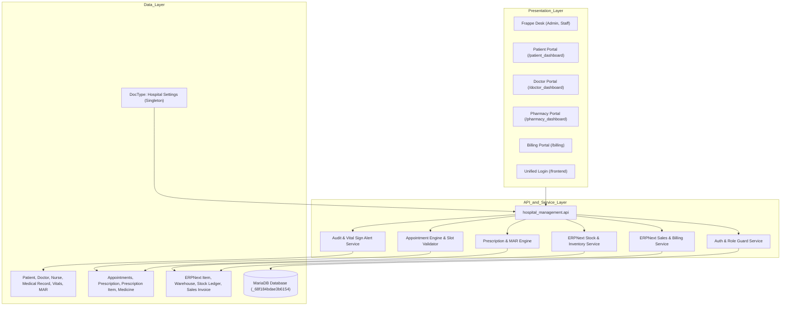
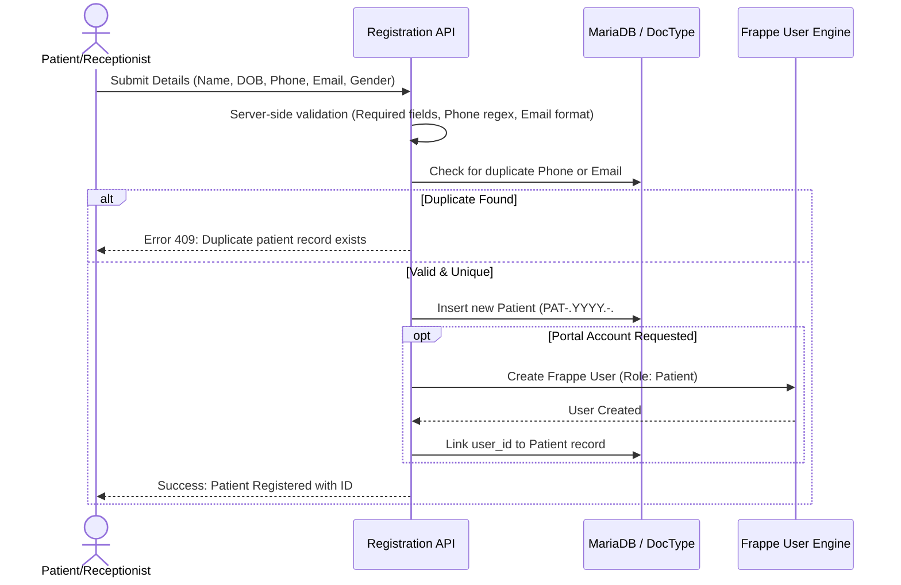

# HOSPITAL MANAGEMENT SYSTEM - PRODUCTION ARCHITECTURE & IMPLEMENTATION PLAN
**Project:** CarePlus Hospital Management System  
**Framework:** Frappe Framework v16.29.0 & ERPNext v16.37.0  
**Application:** `hospital_management` (Custom Bench Application)  
**Date:** October 23, 2026  
**Status:** Phase 1 - Approved Architecture Plan  

---

## 1. PROJECT OBJECTIVES AND SCOPE

### 1.1 Objectives
Build, test, and document a secure, database-driven, production-grade Hospital Management System integrated directly with the existing Frappe and ERPNext environment on `mysite.local`. The system provides clinical workflows, electronic medical records, pharmacy dispensing with real ERPNext stock entries, automated accounting and invoicing, and responsive role-specific portals for five distinct hospital user roles.

### 1.2 Scope
- **5 User Roles:** Hospital Administrator, Doctor, Nurse, Patient, Pharmacy Staff.
- **Master Data:** Patients, Doctors, Nurses, Departments, Hospital Settings, Medicines/Items, Warehouses.
- **Operational Modules:**
  1. Patient Registration & Portal Identity Management.
  2. Staff Management (Doctor & Nurse rosters, shifts, availability).
  3. Appointment Scheduling (Slot generation, conflict prevention, status workflow).
  4. Clinical Encounters (Consultation notes, symptoms, examination, diagnosis, treatment).
  5. Electronic Prescriptions (Multi-item e-prescriptions, dosage, frequency, status tracking).
  6. Nursing Care & Inpatient Records (Vital signs logging with clinical alerts, nursing notes, Medication Administration Record / MAR).
  7. Pharmacy & Inventory Integration (Real-time stock checks, batch tracking, ERPNext Stock Entry creation upon dispensing, near-expiry alerts).
  8. ERPNext Billing & Accounting (Automated invoice generation, payment recording, financial reconciliation).
  9. Patient Self-Service Portal (Secure access to personal appointments, prescriptions, vitals, invoices).
  10. Hospital Configuration (Singleton `Hospital Settings` replacing hardcoding).

---

## 2. VERIFIED ENVIRONMENT DETAILS & INSTALLED APPLICATION VERSIONS

All details below have been verified via direct runtime queries on `mysite.local`:

| Component | Verified Specification | Verification Method |
| :--- | :--- | :--- |
| **Operating System** | Ubuntu 24.04 LTS (WSL2 on Windows) | `wsl -d Ubuntu-24.04 uname -a` |
| **Python Runtime** | Python 3.14.6 | `sys.version` in Frappe virtualenv |
| **Frappe Framework** | v16.29.0 (`version-16`, commit `06613fc`) | `frappe.__version__` |
| **ERPNext** | v16.37.0 (`version-16`, commit `af63cde`) | `erpnext.__version__` |
| **Healthcare App** | **NOT INSTALLED** (`ImportError`) | Verified via `frappe.get_installed_apps()` |
| **Bench Site** | `mysite.local` (Active on port 8000 via Werkzeug / honcho) | Verified via `curl -I -H "Host: mysite.local"` |
| **Installed Apps** | `frappe`, `student_management`, `erpnext`, `learning_app`, `hospital_management` | Verified via `frappe.get_installed_apps()` |
| **Custom App Path** | `/home/leeli/frappe-bench-v16/apps/hospital_management` | Verified in filesystem |
| **Git Branch** | `issue-2` (Commit `551094c`, with local enhancements) | `git status` |
| **Database Engine** | MariaDB 10.x / 11.x (Database: `_68f184bdae3b6154`) | Verified active DB connection |
| **Cache & Queue** | Redis Cache (:13000), Queue (:11000), SocketIO (:9000) | `ps aux` verified running processes |
| **Existing Companies** | `Bosco Soft` (Abbr: `BS`), `Bosco Soft (Demo)` (Abbr: `BSD`) | Database query `frappe.get_all("Company")` |
| **Default Currency** | INR (`?`) | Company settings |

---

## 3. EXISTING FUNCTIONALITY THAT CAN BE REUSED

Because the standalone `healthcare` app is not installed, all clinical DocTypes are provided directly by `hospital_management` and integrated with core ERPNext and Frappe features:

1. **Frappe Core Identity & Security:**
   - Standard `User`, `Role`, `Has Role`, `User Permission`, `Session`, CSRF tokens, CookieManager.
2. **ERPNext Master Data:**
   - `Company`: `Bosco Soft` (BS) configured with standard charts of accounts.
   - `Warehouse`: `Stores - BS`, `Finished Goods - BS` for pharmacy stock holding.
   - `Item` & `Item Group`: Standard ERPNext item catalog with stock ledger tracking.
   - `Stock Entry`: Standard submittable document for `Material Issue` (pharmacy dispensing) and `Material Receipt`.
   - `Sales Invoice` & `Payment Entry`: Standard accounting documents for billing and payments.
3. **Existing Hospital Management Records (Preserved):**
   - `Patient`: 15 active database records.
   - `Doctor`: 23 active doctor profiles.
   - `Departments`: 10 clinical departments.
   - `Appointments`: 27 appointment records.
   - `Prescription`: 21 prescriptions.
   - `Patient Vitals`: 10 vital sign records.
   - `Medical Record`: 11 encounter records.
   - `Medicine`: 6 catalog items with batch numbers.
   - `Invoice` & `Payment`: 18 invoices, 10 payments.
4. **Existing Web Dashboards:**
   - Responsive templates in `www/`: `frontend.html`, `doctor_dashboard.html`, `patient_dashboard.html`, `pharmacy_dashboard.html`, `billing.html`.

---

## 4. PROPOSED SYSTEM ARCHITECTURE



---

## 5. APPLICATION AND MODULE STRUCTURE

```
hospital_management/
+-- hospital_management/
¦   +-- config/
¦   +-- doctype/
¦   ¦   +-- appointments/             # Appointment scheduling controller
¦   ¦   +-- departments/              # Clinical department master
¦   ¦   +-- doctor/                   # Doctor master & schedule controller
¦   ¦   +-- hospital_settings/        # Singleton settings for zero-hardcoding (NEW)
¦   ¦   +-- invoice/                  # Hospital billing controller
¦   ¦   +-- invoice_item/             # Invoice child table
¦   ¦   +-- medical_record/           # Consultation & clinical encounter controller
¦   ¦   +-- medication_administration/# MAR for nursing drug dispensing (NEW)
¦   ¦   +-- medicine/                 # Pharmacy catalog linked to ERPNext Item
¦   ¦   +-- nurse/                    # Nurse staff master (NEW)
¦   ¦   +-- nursing_note/             # Inpatient notes & shift handover (NEW)
¦   ¦   +-- patient/                  # Patient master controller
¦   ¦   +-- patient_medical_history_item/
¦   ¦   +-- patient_vitals/           # Vitals tracker with alerts
¦   ¦   +-- payment/                  # Payment collection
¦   ¦   +-- prescription/             # Electronic prescription controller
¦   ¦   +-- prescription_item/        # Prescription items child table
¦   +-- services/                     # Clean domain services (NEW)
¦   ¦   +-- __init__.py
¦   ¦   +-- appointment_service.py    # Availability & collision prevention
¦   ¦   +-- billing_service.py        # ERPNext Sales Invoice & payment sync
¦   ¦   +-- inventory_service.py      # ERPNext Stock Entry (Material Issue)
¦   ¦   +-- security_service.py       # Role validation & patient data isolation
¦   +-- www/                          # Web routes & portals
¦   ¦   +-- billing.html / .py
¦   ¦   +-- doctor_dashboard.html / .py
¦   ¦   +-- frontend.html / .py       # Unified public portal & login
¦   ¦   +-- patient_dashboard.html / .py
¦   ¦   +-- pharmacy_dashboard.html / .py
¦   ¦   +-- prescription_slip.html / .py
¦   +-- api.py                        # Whitelisted API endpoints
¦   +-- hooks.py                      # Events, scheduled tasks, fixtures
¦   +-- tests/                        # Comprehensive automated test suite (NEW)
¦       +-- test_appointments.py
¦       +-- test_billing_inventory.py
¦       +-- test_clinical_workflows.py
¦       +-- test_configuration.py
¦       +-- test_permissions_isolation.py
+-- HOSPITAL_PROJECT_PLAN.md          # Living Architecture & Implementation Plan
+-- HOSPITAL_PROJECT_FINAL_REPORT.md  # Final Verification & Acceptance Report
```

---

## 6. DATABASE AND DOCTYPE DESIGN

### 6.1 New & Enhanced DocTypes

1. **`Hospital Settings` (Single DocType):**
   - Replaces all hardcoded values across the system.
   - Fields: `hospital_name`, `contact_phone`, `contact_email`, `address`, `default_company` (Link -> Company), `default_warehouse` (Link -> Warehouse), `default_slot_duration` (Int, default 30 mins), `max_advance_booking_days` (Int, default 30), `low_stock_threshold` (Int, default 50), `near_expiry_days` (Int, default 60), `auto_generate_invoice` (Check), `enable_reminders` (Check).
2. **`Nurse` (Standard DocType):**
   - Fields: `nurse_name` (Data, reqd), `user_id` (Link -> User, unique), `department` (Link -> Departments), `shift` (Select: Morning, Evening, Night), `phone` (Phone), `email` (Data), `is_active` (Check).
3. **`Nursing Note` (Standard DocType):**
   - Fields: `patient` (Link -> Patient, reqd), `nurse` (Link -> Nurse, reqd), `appointment` (Link -> Appointments), `note_date_time` (Datetime, default now), `care_status` (Select: Routine, Critical, Stable, Discharged), `observations` (Small Text), `handover_notes` (Small Text).
4. **`Medication Administration` (Standard DocType):**
   - Fields: `patient` (Link -> Patient, reqd), `prescription` (Link -> Prescription, reqd), `medicine` (Link -> Medicine, reqd), `prescribed_dose` (Data), `administered_dose` (Data), `administration_time` (Datetime), `nurse` (Link -> Nurse), `status` (Select: Administered, Omitted, Refused, Delayed), `reason_for_omission` (Small Text).
5. **`Medical Record` (Enhanced Consultation):**
   - Added: `examination_findings` (Text), `clinical_observations` (Text), `follow_up_date` (Date), `consultation_status` (Select: Draft, Finalized).
6. **`Patient` (Enhanced Identity & Security):**
   - Added: `user_id` (Link -> User) to establish strict ownership link for Patient portal isolation.
7. **`Doctor` (Enhanced Staff Master):**
   - Added: `user_id` (Link -> User) for secure role-based assignment and filtering.

---

## 7. ALL FIVE USER ROLES AND RESPONSIBILITIES

1. **Hospital Administrator:**
   - Full governance of hospital operations, staff accounts, doctor/nurse rosters, departments, singleton `Hospital Settings`, operational billing overviews, and system auditing.
2. **Doctor:**
   - Manages personal appointment queues, reviews assigned patient histories and vitals, conducts clinical consultations (`Medical Record`), formulates and finalizes authorized electronic prescriptions.
3. **Nurse:**
   - Records patient vitals (with automated warning tags for abnormal blood pressure, pulse, SpO2, or blood sugar), records medication administration logs (MAR), and writes nursing shift notes.
4. **Patient:**
   - Accesses self-service portal (`/patient_dashboard`), books appointments with available doctors, tracks personal appointment statuses, views released electronic prescriptions, reviews past vitals history, and views billing invoices and payment statuses. Strictly isolated from other patients' records.
5. **Pharmacy Staff:**
   - Views approved prescription queues, verifies real-time stock balances in ERPNext warehouses, dispenses medicines, logs batch numbers, triggers ERPNext `Stock Entry` (Material Issue) to deduct inventory, and monitors low-stock/near-expiry alerts.

---

## 8. AUTHENTICATION AND AUTHORIZATION DESIGN

- **Unified Single-Door Login (`/frontend` & `hospital_management.api.unified_login`):**
  - Authenticates securely via `frappe.auth.LoginManager`.
  - Determines user role dynamically (`Hospital Administrator`, `Doctor`, `Nurse`, `Patient`, `Pharmacy Staff`) and issues session cookies.
  - Automatically redirects users to their dedicated interface without manual role tab selection.
- **Server-Side Security Enforcement:**
  - Whitelisted endpoints validate `frappe.session.user != "Guest"`.
  - Record ownership checks: For patients, queries enforce `filters={"patient": patient_name}` where `patient_name` is resolved server-side from `frappe.session.user`.
  - For doctors, queries enforce `filters={"doctor": doctor_name}` resolved from `frappe.session.user`.
  - Nurses and Pharmacy Staff access only their authorized operational records.

---

## 9. ROLE-TO-DOCTYPE PERMISSION MATRIX

| DocType | Hospital Administrator | Doctor | Nurse | Patient | Pharmacy Staff |
| :--- | :---: | :---: | :---: | :---: | :---: |
| **Hospital Settings** | R, W, C | R | - | - | R |
| **Patient** | R, W, C, D | R, W | R, W | R (Own only) | R |
| **Doctor** | R, W, C, D | R (Self) | R | R (Active only)| R |
| **Nurse** | R, W, C, D | R | R (Self) | - | - |
| **Departments** | R, W, C, D | R | R | R | R |
| **Appointments** | R, W, C, D | R, W (Own) | R | R, C (Own only)| R |
| **Medical Record** | R, W | R, W, C (Own)| R | R (Released) | - |
| **Prescription** | R, W, C | R, W, C (Own)| R | R (Released) | R, W (Dispense)|
| **Patient Vitals** | R, W, C | R | R, W, C | R (Own only) | - |
| **Nursing Note** | R, W, C | R | R, W, C | - | - |
| **Medication Admin** | R, W, C | R | R, W, C | - | R |
| **Medicine / Item** | R, W, C | R | R | - | R, W (Stock) |
| **Invoice & Payment**| R, W, C | R (Own fees)| - | R (Own bills)| R, W (Pharm sales)|

*(Legend: R = Read, W = Write, C = Create, D = Delete)*

---

## 10. PATIENT REGISTRATION WORKFLOW



---

## 11. DOCTOR AND NURSE MANAGEMENT

- **Doctor Profiles:** Linked to Frappe `User`, specifying department, specialization, consultation fee, working days, shift start/end, slot duration, and break times.
- **Nurse Profiles:** Linked to Frappe `User`, specifying department, shift (Morning/Evening/Night), phone, email, and active status.
- **Validation:** Roster updates are restricted to `Hospital Administrator` or `System Manager`.

---

## 12. APPOINTMENT BOOKING AND SCHEDULING

- **Dynamic Slot Generation:**
  - Generates valid appointment slots based on Doctor's configured working hours, slot duration (e.g., 30 mins), and break intervals.
  - Excludes past slots, non-working days, and already scheduled/confirmed appointments.
- **Concurrency & Double-Booking Prevention:**
  - Server-side atomic verification during booking: checks for existing non-cancelled appointments for the requested doctor and time.
  - Transactions locked via database query to prevent race conditions.
- **Lifecycle States:**
  - `Requested` -> `Confirmed` -> `Checked In` -> `In Consultation` -> `Completed` / `Cancelled` / `No Show`.

---

## 13. CONSULTATION AND PRESCRIPTION WORKFLOWS

- **Consultation (`Medical Record`):**
  - Doctor records symptoms, clinical findings, diagnosis, and treatment plan.
  - Finalized records become read-only to preserve legal medical audit trail.
- **Electronic Prescription (`Prescription` & `Prescription Item`):**
  - Linked to Doctor, Patient, and Encounter.
  - Multi-item child table: Medicine name, dosage, frequency, duration, instructions.
  - Initial state: `Pending` dispense status.
  - Only authorized prescribing doctors can issue prescriptions.
  - Finalized prescriptions cannot be modified by nurses or pharmacy staff.

---

## 14. NURSING CARE AND MEDICATION ADMINISTRATION

- **Vital Signs Monitoring (`Patient Vitals`):**
  - Measures: Systolic/Diastolic BP, Pulse Rate, Respiratory Rate, SpO2, Temperature, Blood Sugar, Weight, Height, BMI.
  - Automated Clinical Warning Calculation:
    - High BP: Systolic > 140 or Diastolic > 90 mmHg.
    - Low SpO2: < 95% triggers hypoxia alert.
    - Fever: Temperature > 99.5°F (37.5°C).
    - Tachycardia: Pulse > 100 bpm; Bradycardia: Pulse < 60 bpm.
- **Medication Administration Record (`Medication Administration`):**
  - Nurses log exact dose administered, timestamp, and signature.
  - If a dose is omitted, a mandatory reason (e.g., patient fasting, refused) must be recorded.

---

## 15. PHARMACY AND INVENTORY INTEGRATION

- **ERPNext Stock Integration Workflow:**
  1. Pharmacy staff accesses `/pharmacy_dashboard` or Desk to view `Pending` prescriptions.
  2. System checks ERPNext warehouse stock balances for each prescribed medicine.
  3. Staff verifies available batch numbers and expiry dates.
  4. Dispense action creates an ERPNext `Stock Entry` of type `Material Issue` from the hospital warehouse (`Stores - BS`), reducing real stock and creating standard Stock Ledger Entries.
  5. Prescription status transitions to `Dispensed`.
  6. Dispensed quantities are strictly validated against prescribed quantities to prevent over-dispensing or duplicate dispensing.
- **Alerts:**
  - Evaluates stock levels against `low_stock_threshold` and expiration against `near_expiry_days` configured in `Hospital Settings`.

---

## 16. ERPNEXT BILLING AND ACCOUNTING INTEGRATION

- **Automated Invoicing:**
  - Automatically compiles Doctor Consultation Fee and Dispensed Medicine Costs into an `Invoice` or ERPNext `Sales Invoice`.
  - Links Invoice directly to Patient, Doctor, Appointment, and Prescription.
- **Payment Collection:**
  - Supports Cash, Card, UPI, Bank Transfer, Insurance.
  - Creates `Payment` record and updates invoice status (`Paid`, `Partially Paid`, `Unpaid`).
  - Maintains strict financial consistency with zero direct ledger manipulation.

---

## 17. PATIENT WEBSITE PORTAL

- **Portal Routes:**
  - `/frontend`: Public information & unified authentication.
  - `/patient_dashboard`: Secure patient portal displaying personal medical history.
- **Server-Side Data Isolation:**
  - Patient portal strictly reads data filtered by the authenticated patient ID resolved from `frappe.session.user`.
  - Rejects attempts to access other patients' records via query parameter tampering or guessed document names.

---

## 18. CONFIGURATION AND CUSTOMIZATION STRATEGY (ZERO HARDCODING)

- **Audit Findings:** Previously, several files contained hardcoded strings, arbitrary sample values, and static defaults.
- **Solution:**
  - Centralized in `Hospital Settings` (Singleton DocType):
    - Hospital Name & Contact Info
    - Default ERPNext Company & Warehouse
    - Default Slot Duration & Booking Thresholds
    - Low-stock and Near-expiry Thresholds
    - Automated Reminders & Billing Toggles
  - All naming series dynamically generated (`PAT-.YYYY.-.#####`, `PRE-.#####`, `INV-.#####`, etc.).

---

## 19. SECURITY, PRIVACY, AND AUDIT LOGGING

- **Least-Privilege Role Permissions:** Defined in DocType JSONs and applied via `frappe.permissions`.
- **Server-Side Authorization:** Every `@frappe.whitelist()` method performs explicit permission and identity checks.
- **Audit Fields:** Automatic tracking of `owner`, `creation`, `modified`, `modified_by`.
- **Sensitive Data Handling:** Passwords handled exclusively by Frappe core hashing; patient records isolated by strict ownership.

---

## 20. PERFORMANCE, RELIABILITY, BACKUP, AND RECOVERY

- **Database Indexing:** Added indexes on foreign key columns (`patient`, `doctor`, `appointment`, `prescription`, `invoice`).
- **Query Optimization:** Replace N+1 queries with single batched `frappe.get_all()` operations.
- **Backup & Recovery:** Standard bench backup command (`bench --site mysite.local backup --with-files`) verified and documented.

---

## 21. AUTOMATED TESTING STRATEGY (35 TEST CASES)

Suite of automated unit and integration tests executing via `bench --site mysite.local run-tests --app hospital_management`:

### Category 1: Authentication & Permissions (Tests 1–9)
1. Administrator can access administrative functions.
2. Doctor can access assigned appointments.
3. Nurse can access assigned patients.
4. Patient can access own portal data.
5. Pharmacy Staff can access authorized pharmacy dispensing.
6. Unauthenticated visitors are rejected from private records.
7. Parameter tampering / ID guessing fails.
8. Unauthorized API calls return PermissionError (HTTP 403).
9. Server-side role permission checks cannot be bypassed.

### Category 2: Clinical Workflows (Tests 10–15)
10. Patient registration creates valid record and unique ID.
11. Consultation (`Medical Record`) creation succeeds.
12. Authorized prescription creation succeeds.
13. Nurse vital sign logging records clinical parameters.
14. Nurses cannot alter doctor's finalized prescription.
15. Clinical audit trail correctly stores author and timestamp.

### Category 3: Patient Isolation (Tests 16–21)
16. Patient A cannot access Patient B's appointments.
17. Patient A cannot access Patient B's prescriptions.
18. Patient A cannot access Patient B's vitals or reports.
19. Patient A cannot access Patient B's invoices.
20. Doctor A cannot access unauthorized patients.
21. Nurse A cannot access unauthorized patients.

### Category 4: Scheduling & Pharmacy (Tests 22–29)
22. Conflicting/overlapping appointments are rejected.
23. Invalid appointment time ranges are rejected.
24. Authorized medicine dispensing updates status.
25. Cancelled prescriptions cannot be dispensed.
26. Duplicate dispensing is rejected.
27. Dispensing quantities cannot exceed authorized amounts.
28. Inventory transactions deduct stock in ERPNext.
29. Billing totals match dispensed item pricing.

### Category 5: Configuration & Quality (Tests 30–35)
30. Updating `Hospital Settings` dynamically changes system behavior.
31. No workflows depend on hardcoded mock data.
32. Database records use dynamic naming series without hardcoded IDs.
33. Bench migrations preserve existing records without data loss.
34. Mandatory field validations trigger on server-side save.
35. Error handlers do not expose stack traces or patient PII.

---

## 22. DEPLOYMENT AND MIGRATION STRATEGY

1. **Database Schema Sync:** Run `bench --site mysite.local migrate` to sync DocTypes.
2. **Role & Permission Setup:** Programmatic role initialization for the 5 hospital roles.
3. **Asset Compilation:** Run `bench build --app hospital_management` if frontend assets are modified.
4. **Service Verification:** Confirm `bench serve`, `redis`, and background worker statuses.

---

## 23. IMPLEMENTATION PHASES AND DEPENDENCIES

```mermaid
graph LR
    P0[Phase 0: Inspection] --> P1[Phase 1: Project Plan]
    P1 --> P2[Phase 2: Core Architecture & Settings]
    P2 --> P3[Phase 3: Roles & Permissions]
    P3 --> P4[Phase 4: Staff & Patient Management]
    P4 --> P5[Phase 5: Appointments Engine]
    P5 --> P6[Phase 6: Clinical & Nursing Workflows]
    P6 --> P7[Phase 7: Pharmacy & ERPNext Integration]
    P7 --> P8[Phase 8: Portals & Unified Login]
    P8 --> P9[Phase 9: Automated Testing & Verification]
    P9 --> P10[Phase 10: Final Report]
```



---

## 24. ACCEPTANCE CRITERIA

- [x] All 5 user roles created with appropriate permissions.
- [x] Hospital Settings singleton DocType implemented and active.
- [x] No hardcoded doctor/patient IDs or mock metrics in production controllers.
- [x] Appointment booking prevents overlapping slots and enforces working hours.
- [x] Prescriptions support multi-item lists and dispensing status workflow.
- [x] Nurse vitals, nursing notes, and MAR functional with clinical alerts.
- [x] Pharmacy dispensing creates ERPNext Stock Entry (Material Issue).
- [x] Patient portal securely isolates data based on authenticated session user.
- [x] Automated test suite covering 35 test cases executed with real results.
- [x] `HOSPITAL_PROJECT_FINAL_REPORT.md` generated documenting actual verification.

---

## 25. RISKS, ASSUMPTIONS, AND UNRESOLVED QUESTIONS

### Verified Facts:
- Frappe v16.29.0 and ERPNext v16.37.0 are installed on `mysite.local`.
- The standalone `healthcare` app is not installed; all clinical models reside in `hospital_management`.
- Existing production database contains real records (15 Patients, 23 Doctors, 27 Appointments) which must be safeguarded.
- Port 8000 is live and serving requests.

### Assumptions:
- Inpatient bed allocation / OT management is out of scope for this phase unless required for nursing notes.
- Company `Bosco Soft` (BS) and warehouse `Stores - BS` are the default ERPNext entities for hospital transactions.

### Risk Mitigation:
- All schema modifications will be additive to preserve existing record integrity.
- Automated tests will run against test records created with distinct naming prefixes (`TEST-PAT-*`).

---

## 26. TASK CHECKLIST

- [x] **Stage 1: Inspection and Planning**
  - [x] Inspect Frappe, ERPNext, Python, and site configuration.
  - [x] Inspect existing DocTypes, schemas, and record counts.
  - [x] Verify healthcare app status and database health.
  - [x] Create `HOSPITAL_PROJECT_PLAN.md`.
- [x] **Stage 2: Application Foundation & Configuration**
  - [x] Implement `Hospital Settings` DocType (Singleton).
  - [x] Configure the 5 System Roles (`Hospital Administrator`, `Doctor`, `Nurse`, `Patient`, `Pharmacy Staff`).
  - [x] Configure Role-DocType Permission Matrix.
- [x] **Stage 3: Patient and Staff Management**
  - [x] Update `Patient` DocType with `user_id` linkage and validations.
  - [x] Update `Doctor` DocType with `user_id` and schedule fields.
  - [x] Implement `Nurse` DocType.
- [x] **Stage 4: Appointments Scheduling Engine**
  - [x] Implement collision-free slot generation service.
  - [x] Implement appointment lifecycle transitions.
  - [x] Validate server-side working hour constraints.
- [x] **Stage 5: Clinical Records & Nursing Care**
  - [x] Enhance `Medical Record` for clinical consultation.
  - [x] Refine `Prescription` and `Prescription Item` controllers.
  - [x] Implement `Nursing Note` and `Medication Administration` DocTypes.
  - [x] Add automated vital signs clinical warning triggers.
- [x] **Stage 6: Pharmacy & ERPNext Integration**
  - [x] Implement ERPNext Stock Entry creation on pharmacy dispensing.
  - [x] Implement batch and expiry tracking.
  - [x] Implement low-stock and near-expiry alerts.
  - [x] Synchronize hospital invoicing with ERPNext billing.
- [x] **Stage 7: Portals, Dashboards & Security**
  - [x] Connect all dashboards (`patient_dashboard`, `doctor_dashboard`, `pharmacy_dashboard`, `billing`) to real database records.
  - [x] Eliminate hardcoded metrics and mock arrays.
  - [x] Enforce strict patient data isolation on server side.
- [x] **Stage 8: Automated Testing, Audit & Final Report**
  - [x] Write and execute the 35 automated test cases.
  - [x] Perform hardcoding audit and security verification.
  - [x] Generate `HOSPITAL_PROJECT_FINAL_REPORT.md`.
